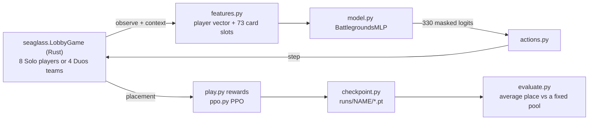

# Seaglass RL (`rl/`)

`seaglass-rl` is the Python reinforcement learning project for training agents to play Hearthstone Battlegrounds on top of the [`seaglass` Rust engine](../engine/README.md).

**All game rules live in Rust; all RL decisions live in Python.**
This package never reimplements a card, cost, legality check, or combat step—it calls the `seaglass` native extension for state transitions and batch combat simulations, while keeping the MDP formulation (observation encoding, action space mapping, reward shaping, and opponent curriculum) and neural network training in Python for rapid iteration.

---

## Overview



| Module | What it does |
| :--- | :--- |
| `seaglass.LobbyGame` (Rust) | The game: a full lobby, Solo (2..8 players) or Duos (2..4 teams of 2), with one shared card pool. It runs the hero offers, each turn's pairings, ghosts, combats, knockouts and placements, and records every game as a replay ([`engine/docs/lobby_game.md`](../engine/docs/lobby_game.md)). `context(p)` is what player `p` knows about the lobby. Python holds no game logic. |
| `play.py` | `LobbyConfig` (the lobby settings) and `Seat` (one player with the `TavernGame` interface, so the bots and `action_mask` play Solo and Duos alike). `play_games`: plays many lobbies in lockstep with one batched forward pass per model, with a mix of controllers per unit (`"learner"`, `"heuristic"`, `"random"`, or a named model such as a checkpoint), and records the learner's decisions as trajectories. `Player` spreads games over worker processes. |
| `ppo.py` | GAE with **per-turn discounting** and a minibatched, KL-limited PPO update. |
| `train_lobby.py` | The trainer (below). |
| `pretrain.py` | Behavior cloning on rule-bot games (policy cross-entropy + value loss), the starting point for PPO (`train_lobby.py --init`). |
| `evaluate.py` | Average placement (with standard error, top-half and first-place rates) of a checkpoint against a fixed pool. |
| `ladder.py` | Rates any agent on a fixed ladder of rule bots (paired seeds, clustered standard errors, behavior by turn) and compares two ratings. |
| `positioning.py` | Board order by search: the environment orders a model's board at the end of each turn (`--auto-position`). |
| `probe.py` | The per-turn board probe: the win rate of an end-of-turn board against a frozen library of reference boards from the same turn. |
| `checkpoint.py` | `save` / `load`. A checkpoint stores the model's config and weights, the optimizer state, and the feature spec it was trained on; loading one with another feature spec fails. |
| `features.py`, `actions.py`, `model.py` | The observation encoding, the 330 flat actions with their legality mask, and the network. |
| `seaglass.Encoder` (`engine/src/python/encode.rs`) | The observation encoding and the legality mask, ported to Rust bit for bit (about 10x faster per call; a self-play core plays about 1.8x (transformer) to 2x (MLP) as many games per second). `features.py` and `actions.py` stay the reference and own the layout: `features.encoder_spec()` hands Rust the vocabularies, the action table and every offset, and the Rust code holds only the formulas (`tests/test_rust_encoder.py` checks every decision of whole lobbies for exact equality). `play_games` uses it by default for model and recorded-bot seats when the extension has it; `PlayOptions(rust_encoder=False)` switches back to the Python path. Rebuild the extension after changing the layout in `features.py`: a layout whose blocks do not add up is rejected at construction. |
| `bots.py` | `RandomBot`, `HeuristicBot` (picks the best stats, plays everything, levels on curve), `PolicyBot`. |
| `env.py`, `train_ppo.py` | **Legacy**: the earlier head-to-head 2-player env (`BattlegroundsEnv`) and its trainer. |
| `replays.py` | Recorded matches as training arrays (`to_dataset`), e.g. for behavior cloning. |

---

## Training (`train_lobby.py`)

```bash
python -m seaglass_rl.pretrain --out runs/bc-solo.pt --games 400                 # clone 9kgamerbot
python -m seaglass_rl.train_lobby --run-dir runs/solo --init runs/bc-solo.pt --lr 1e-4
python -m seaglass_rl.train_lobby --run-dir runs/solo --iterations 500           # Solo, 8 players, from scratch
python -m seaglass_rl.train_lobby --run-dir runs/duos --duos --iterations 500    # Duos, 4 teams
python -m seaglass_rl.train_lobby --run-dir runs/solo --resume runs/solo/latest.pt --iterations 500
python -m seaglass_rl.evaluate runs/duos/latest.pt --duos --games 200
```

**Start from behavior cloning.** From scratch, an untrained policy places last against rule bots nearly every game, and a reward that arrives only at the end of the game is too weak to climb out from there. `pretrain.py` clones a rule bot (`--teacher`: `9kgamerbot` by default, or `9kgamerbot-tempo` or `heuristic`) from games where every seat is that bot. It collects `--chunk` (40) games at a time to bound memory. With the old HeuristicBot teacher it took about a minute for 95% held-out action accuracy. PPO then starts from there (`--init`). Pretrain records and trains under the same move rules as the PPO run that follows: give it the same `--no-reposition`, `--no-freeze`, `--no-positioning-phase`, `--prune` and `--max-steps-per-turn`. They are saved in the checkpoint, so `ladder.py` rates it under them. The critic is not trained by default (`--value-epochs 0`): a cloned critic memorises its games' outcomes, and on whole held-out games it did worse than a uniform guess from the first epoch. With `--value-epochs N` it is trained like PPO's (below), with cross-entropy against the seat's final place. The held-out set is whole games. Bots shop, reposition and freeze in one go and never see the end-of-turn step (below), so each recorded End Turn is followed by a recorded End Turn in that step. Without it, a clone wanders in the step: the HeuristicBot clone made 12 actions a turn against its teacher's 6.

The policy's logits get a **kind prior** (`model.py`, on for `train_lobby`): each is lowered by log(number of legal actions of its kind). An untrained policy then picks among Buy, Play, Reposition, End Turn and the rest evenly, instead of mostly Repositioning: there are 42 Reposition actions and 1 End Turn.

Each iteration plays `--games` lobbies (64) across `--workers` processes (default: half the cores):
- **Who plays.** The learner controls `--learner-units` units: half by default, so 4 Solo players or 2 Duos teams. In Duos both teammates use the learner's policy, each acting on their own Tavern. Each other unit is, with chance `--p-bot` (30%), a rule bot drawn evenly from `--bots` (`9kgamerbot,9kgamerbot-tempo` by default), and otherwise a frozen snapshot of the learner. Before the first snapshot every opponent is a bot (with `--pure`, the learner fills every seat). Snapshots are taken every `--snapshot-every` iterations and all are kept on disk. Each iteration's snapshot opponents are the latest `--pool-recent` (4) plus `--pool-history` (4) drawn at random from the older ones, so the league keeps past selves in the field. A game only sends its workers the snapshots it uses.
- **Reward.** The unit's **placement**: +1 for first down to -1 for last, linear (`play.placement_reward`). A Duos team's two players share it.
- **Optional shaping.** `--shaping` (default 0, off) adds potential-based shaping, γ·Φ(s′) − Φ(s), with Φ = shaping × log1p(`env.compute_board_power`). Being potential-based, it changes no optimal policy; it only gives credit earlier. It is off because the stat-sum potential rewards buying stats now, and it is blind to scaling.
- **Discounting and λ.** `--gamma` (1) applies once per turn, not per action. `--lam` (0.95) now applies once per turn too (`--lam-per turn`): the actions within a turn are one step of GAE, so credit decays by λ per turn, not per action. `--lam-per action` applies it at every action, as before.
- **The critic.** `--value-head placement` (the default) makes the critic a distribution over the final place, 1 to 8 in Solo (`value_places` in the model's config). It is trained with cross-entropy against the unit's final place. The value PPO uses is its expectation over the placement rewards (+1 for first to -1 for last, linear). That equals the return only with `--gamma 1` and no shaping, so the trainer exits if you combine a placement critic with `--gamma` other than 1, `--shaping` or `--health-shaping`. `--value-head scalar` keeps the old scalar critic, which old checkpoints have. With `--init` or `--resume`, the head comes from the checkpoint.
- **Actions.** Everything is unmasked, including Freeze. `--prune` restores the `prune_dominated` sell and refresh rules. A turn is force-ended after `--max-steps-per-turn` (30) actions.
- **End-of-turn step.** A model's turn has two parts. **Shopping** covers everything but Reposition and Toggle Freeze; where a card is played still picks its slot. Choosing End Turn opens an **end-of-turn step** ("prepping the board for battle") when there is something to do in it. The only legal actions in the step are Reposition (at most board size − 1 moves, with 2+ minions), **one** Toggle Freeze, and End Turn. The turn ends once nothing is left to do. The observation flags the step (`features.PHASE_OFFSET`). `--no-positioning-phase` allows repositioning and freezing at any time. Without the step, the models made 6–12 moves a turn, and toggled Freeze on and off to pad turns.
- **Damage caps.** Lobbies cap combat damage as the game does (`engine/docs/lobby_game.md` §5). `--no-damage-caps` turns this off.
- **The old behavior.** `--gamma 0.97 --lam-per action --shaping 0.3 --value-head scalar --p-heuristic 0.3 --pool-size 10` restores the earlier defaults (HeuristicBots and the last ten snapshots). For `pretrain.py`, the old behavior is `--teacher heuristic --value-head scalar`.
- **Auxiliary head (`--aux-coef`, `--aux-horizons`).** Placement arrives once a game, and levelling or buying a scaling engine costs strength now and pays a few turns later. With `--aux-coef` > 0 (default 0, off), the model gets one extra logit per horizon, predicting the board probe score (`probe.py`: an end-of-turn board's win rate against a fixed library of reference boards from the same turn, in [0, 1]; it names no cards) that many turns ahead (`--aux-horizons`, default `0,2,4`; 0 is this turn's board). The head is a linear layer on the trunk (the MLP's hidden features, the transformer's player token), trained with binary cross-entropy times `--aux-coef`, averaged over the targets that exist; a decision's target is missing when the seat was knocked out by then, the game ended, the library has no boards for that turn, or in the hero phase. Nothing else changes: the head is not used to act, and with the flag off the model and its checkpoints are unchanged. A model can't grow a head in place, so `--init` / `--resume` need a checkpoint trained with the same number of horizons (the trainer exits otherwise). `aux_loss` is logged per iteration. Cost: the rollout scores every recorded seat's board each turn (`PlayOptions.aux_probe`), about 10% more rollout time with 4 recorded seats of 8 on one core (measured), plus the one-time library build in each worker. Solo only.
- **Update.** `--epochs` (4) passes of minibatches (`--minibatch` 4096). An epoch stops early once the approximate KL passes 1.5 × `--target-kl`.

Every `--eval-every` iterations, the learner is rated on a ladder of rule bots (`--eval-ladder`: `fast`, the default in 8-player Solo, or `slow`; see "Rating agents" below) and `latest.pt` is saved. `--eval-games` sets the lobbies (default: the ladder's own, 500 fast or 100 slow), and `--no-eval-probe` skips the board probe. `--eval-ladder heuristic` keeps the older check: the learner alone against HeuristicBots (96 lobbies). The ladders need an 8-player Solo lobby, so Duos and smaller lobbies default to `heuristic`. `runs/NAME/` holds:
- `args.json`;
- `log.jsonl`, one line per iteration: the learner's average place, steps, losses, entropy, KL, explained variance, and a summary of the evaluation (`eval`);
- `latest.pt`;
- `snapshots/iter_XXXXX.pt`;
- `evals/iter_XXXXX.json`, the full ladder result of each evaluation.

Evaluation. An agent as good as the field places `(units + 1) / 2` on average: 4.5 in Solo, 2.5 in Duos. Lower is better.

**Automatic positioning (`--auto-position`).** The simulator can score a board order exactly, so the environment can order the board instead of the policy learning 42 Reposition logits from the final place. With `--auto-position` (meant for `--no-reposition`), just before a model seat's turn ends, `positioning.py` searches for a better order with the combat simulator. It scores each order by its win rate (a draw counts half) against up to 4 opponent boards: the boards this player has seen (the next opponent first, then the most recently seen), filled up from the probe library's reference boards for the turn. Every order uses the same fight seeds, 2 fights per opponent. The search is a first-improvement hill climb over swaps with a budget of 16 scored orders per turn, and knows nothing about cards. The moves are counted as `auto_position` actions and never enter a trajectory. It applies to model seats only, Solo only. Cost: about 0.4 ms per seat-turn with a 5-minion board and 0.8 ms with 6 (measured on the Mac mini, 4 opponents, whole search), plus the one-time library build (a few seconds) in each worker. `ladder.py` rates a checkpoint with it when it was trained with it; `rate --auto-position on|off` overrides that. **Measured gain: none so far.** On the fast ladder, the 150-game 9kgamerbot clone placed 5.22 without it, 5.21 with it, and 5.25 with a search 16 times larger (8 opponents, 8 fights each, 48 orders). Each is ± 0.13 at two sigma. So it is off by default; try it again once agents build boards where order matters more.

### Rating agents (`ladder.py`)

One command rates any agent (a checkpoint or a bot name) and compares two ratings:

```bash
python -m seaglass_rl.ladder rate runs/solo/latest.pt --out results/a.json
python -m seaglass_rl.ladder rate 9kgamerbot --out results/9k.json
python -m seaglass_rl.ladder rate runs/solo/latest.pt --ladder slow     # adds a SovereignBot seat; slow
python -m seaglass_rl.ladder compare results/a.json results/b.json
```

- **Ladders.** The agent takes 2 of 8 Solo seats. The **fast** ladder fills the rest with two each of `9kgamerbot`, `9kgamerbot-tempo` and `heuristic`, and plays 500 lobbies (1,000 seat-games). The **slow** ladder swaps in one `sovereign` seat and plays 100 lobbies; SovereignBot costs 30 to 50 seconds of CPU per game, so run it rarely. The seeds and the seat shuffle are fixed and do not depend on the agent, so every agent on the same ladder and seed plays the same lobbies in the same seats.
- **Reported.** Average place (4.5 is level, lower is better) with its standard error, clustered by lobby because the agent's two seats in a lobby are not independent. Also the top-4 and first-place rates, the same for each anchor, and behavior by turn: Tavern Tier, Gold left, health, board size and actions (buys, rolls, levels), next to the anchors' Tier. The result file records the commit, whether the tree was dirty, and a fingerprint of the engine build.
- **The probe.** Placement arrives once per game and is noisy. The probe (`probe.py`) fights the agent's end-of-turn board against a frozen library of reference boards from the same turn, made by lobbies of the rule bots on fixed seeds, and reports the win rate by turn (a draw counts half). It is a dense signal: it shows whether an agent trades early strength for late strength. Its limits: the fights are board-only, so Hero Powers, trinkets and other effects outside the board are not included, and late turns have only survivors on both sides. The library is rebuilt at each start (a few seconds), not stored.
- **Checkpoints** are rated under the move rules they were trained with (the step cap, if any, the end-of-turn step, `--no-reposition`, `--no-freeze`, `--prune`), read from the checkpoint's saved arguments.
- **Comparing.** `compare` reports the difference in average place with its standard error, and whether it is within 2σ. If both results used the same seed, it also reports the paired difference per lobby. Pairing narrows the interval only a little (about 5% in the Stage 1 runs), because an agent's own play soon changes how a lobby goes. A difference inside 2σ is noise. Every claim that one agent beats another should cite the ladder result files it came from.

### Search inside the turn (`search.py`)

Inside a turn the simulator is exact, except for hidden randomness (refreshes, Discovers). So a model seat can search there, with its own policy to propose moves and its own critic to judge them. No play rules and no card knowledge go in.

- **A line** is the rest of the turn. It starts with one root action. Then the policy plays on, sampling at `SearchSpec.temperature` (0 is greedy), under the same move rules as `play_games` (in the shopping step Reposition and Toggle Freeze are masked when the end-of-turn step is on). It ends when the policy picks End Turn, or after `max_line` actions.
- **The score** of a line is the critic's value of its last state, encoded with `arranging=True`: the state the critic sees at a turn's last decision in training. The value is the expected placement reward, in [-1, 1]. There is no combat and no later turn.
- **The belief Tavern.** Each line runs in `LobbyGame.belief_tavern(p, seed)`: the player's own state with a card pool rebuilt from what the player can see. The search never sees the true pool or the true shop to come. The live game is not touched. Lines use the same belief seeds for every candidate (common random numbers), so candidates are compared on the same futures.
- **Choosing the root action.** Gumbel MuZero's sequential halving. The candidates are the top `top_m` legal actions by Gumbel noise plus logit (`gumbel_noise=False`, for play, means no noise). There are `ceil(log2(top_m))` phases. Each gives every remaining candidate `max(1, sims // (phases * remaining))` lines. Then the better half by `g + logit + sigma(Q)` goes on, where `Q` is the mean line score and `sigma(q) = (c_visit + max visits) * c_scale * (q + 1) / 2`. The last candidate is played. The lines run in all are at most `max(sims, sum of the candidates left over the phases)`. For `top_m=8, sims=16` that is 16 (`line_budget` gives the exact plan).
- **Skipped.** With fewer than 2 legal actions, in the end-of-turn step, and in the hero phase, the plain policy plays.
- **The targets.** `search_decision` also returns the improved policy `softmax(logit + sigma(completed Q))` over the legal actions (the candidates' `Q`, and `v_mix` for the rest) and the root value. With `PlayOptions.search` set and a searching seat recorded, `Trajectory.search_policy` keeps the target of every decision (float16 in `arrays()`; zeros where the decision was not searched). The recorded action, log-probability and value are the played action's under the plain policy and the critic's root value, so PPO data stays valid. Nothing trains on the targets yet.
- **Cost.** About 100 ms per searched decision for the default `SearchSpec()` (8 candidates, 16 lines) with the 64-wide transformer on 2 CPU threads, and a few dozen batched forwards. Cost is about linear in `sims` (lines) and in the length of a line. `top_m` mostly changes how the lines are spread. Solo only. Searches are coroutines (`search_coroutine`) driven together by `run_searches`: in `play_games`, every searching seat of every lobby in a lockstep step runs at once, and each round makes one forward per model over all their rows (root, line steps and end-of-turn scoring). A seat-game therefore costs far fewer, much larger forwards (about 20 rows each instead of 4 in the 8-lobby, 2-seat measurement) and about a quarter less wall time on one core; the more lobbies and searching seats a worker plays at once, the bigger the batches. Batch composition can change float results in the last bits, so a search is reproducible for a given set of lobbies but not bit-identical to the same seat searched alone.
- **Using it.** `PlayOptions(search=SearchSpec(), search_controllers=("agent",))`, or on the command line:

```bash
python -m seaglass_rl.ladder rate runs/solo/latest.pt --search --search-m 8 --search-sims 16
python -m seaglass_rl.ladder versus runs/solo/latest.pt runs/solo/latest.pt --search-a --games 200 --out results/search.json
```

`versus` is the most sensitive check: agents `a` and `b` take 4 seats each in every Solo lobby (seats shuffled by the seed alone) and it reports `a`'s average place (4.5 is level) with its standard error clustered by lobby, top-4 and first-place rates for both, and the places by lobby. The two may be the same checkpoint, with only one searching. Both must play under the same move rules, and if both search they must use the same `SearchSpec`. `rate --search` rates the agent with search on the ladder; a bot cannot search.

### Distilling search (`distill.py`)

Expert iteration, offline: the network learns to play the way its own in-turn search does, then is checked against the network it started from. PPO can continue from the distilled network afterwards.

```bash
python -m seaglass_rl.distill generate --model runs/solo/latest.pt --lobbies 2000 --search-seats 2 --out runs/distill/data --workers 6
python -m seaglass_rl.distill train --init runs/solo/latest.pt --data runs/distill/data --out runs/distill/student.pt
```

- **`generate`** plays Solo lobbies in which `--search-seats` seats (shuffled per lobby) are the model with search and Gumbel noise at the root (`searcher`) and the others the same checkpoint without search (`rival`), under the checkpoint's move rules. Only the searchers are recorded: one compressed `.npz` shard per `--chunk` lobbies with the packed observations, `actions`, `search_policy` (float16; zero rows where a decision was not searched, flagged by `searched`), `places` (0-based final place of each decision's seat) and `game` (the lobby index), plus `meta.json` (checkpoint, search spec, seeds, commit, engine fingerprint).
- **`train`** starts from the checkpoint's weights and minimizes `policy + vf_coef * value + anchor_coef * anchor`: the cross-entropy of the masked log-softmax against `search_policy` on searched rows; the placement critic's cross-entropy against `places` on all rows (a scalar critic is refused); and KL(pi_init || pi_theta) on all rows against a frozen copy of the start, which keeps the network near a policy known to be strong. Whole games are held out; each epoch prints the held-out policy cross-entropy, `agree` (the searched rows where the network's argmax is the search's, next to the start's), value cross-entropy and the KL to the start. The saved checkpoint keeps the original `args` (so the ladder rates it under the same move rules) and adds `extra["distill"]`.
- **The gate.** The distilled network, both without search, against the one it started from: `python -m seaglass_rl.ladder versus runs/distill/student.pt runs/solo/latest.pt --games 200`. It passes when `a`'s average place is below 4.5 by more than the standard error.

### Packed trajectories

The trainer and `pretrain.py` store trajectories packed (`PlayOptions(pack=True)`; `train_lobby.play_options` sets it, `pretrain --no-pack` keeps the dense format). A decision's `slot_num_feats` is over 97% zeros, so `Trajectory.arrays(pack=True)` returns it as CSR rows over the flattened `NUM_SLOTS * SLOT_NUM_DIM` values: `num_ptr` (int64, T+1), `num_idx` (uint16 columns), `num_val` (float16, the same numbers the dense float16 array holds). The action mask becomes `mask_bits` (`np.packbits`, uint8), `slot_card_ids` is uint16, and `packed` is True. A decision shrinks from about 21.5 KB to about 1.5 KB. `packing.py` has `pack_rows`, `concat_packed`, `unpack_rows` and `unpack_mask`; `ppo.build_batch` keeps a packed batch packed (it refuses a mix of packed and dense trajectories), and `ppo_update` and `pretrain.train` densify one minibatch at a time. The default, `pack=False`, is the dense format that `replays.py`, `train_ppo.py` and the bots expect. With the Rust encoder, `pack=True` never builds the dense float16 stack: `Encoder.encode(..., sparse=True)` (`fast_encode(..., sparse=True)`) returns each decision's nonzero columns and float32 values, `play.py` keeps them as uint16/float16 (dropping values that underflow to zero in float16) and `arrays(pack=True)` assembles the CSR rows from them, bit-identical to `pack_rows` and about 2.5x smaller in worker memory while a game runs.

### Devices and CPU use

Self-play always runs on the CPU, in `--workers` processes. Only the gradient updates (`train_lobby`, `pretrain`) move to `--device`: `auto` (the default) picks CUDA, then Apple's MPS, then the CPU. Evaluation stays on the CPU. Checkpoints always hold CPU tensors, so they load anywhere.

Three environment variables set the defaults for the whole machine; a flag wins over them:
`SEAGLASS_DEVICE` (`auto`, `cpu`, `mps`, `cuda`), `SEAGLASS_WORKERS` (self-play processes) and `SEAGLASS_THREADS` (torch threads in the trainer). Without them, workers and threads default to half the cores (threads at most 8). While another job shares the machine, turn things down: `SEAGLASS_WORKERS=3 SEAGLASS_THREADS=2 python -m seaglass_rl.train_lobby --run-dir runs/solo`, or add `--device cpu` to leave the GPU to it.

How much the GPU helps depends on the model's size. On an M-series Mac (MPS), the update of a 224-wide, 6-layer transformer runs about 2x faster than on the CPU, but the default MLP and the default 64-wide transformer gain little. The first iterations are slower while MPS compiles each new batch shape.

### Simplifications compared with the real game
- No damage cap (`engine/docs/deferred.md`).
- A game still running after `--max-turns` (30) places the survivors by Health plus Armor.

---

## Observation (`features.py`)

`encode_observation(obs, context=None)` returns `(player_vec, slot_card_ids, slot_num_feats)`:

- **`player_vec`** (`PLAYER_DIM` = 192):
  - The player's Tavern: 33 features (`TAVERN_PLAYER_DIM`), described in the sections below.
  - The lobby (`LOBBY_DIM` 20, all 0 without a `context`): units, units alive, Health rank, whether the next opponent is a ghost, the next opponent's Health, Armor and Tier, this turn's damage cap (capped, cap / 15), and the lobby's 5 minion types (a multi-hot of the 10).
  - 7 opponents × 10 features (`OPPONENT_DIM`): present, alive, Health, Armor, Tier, win streak, is next, is last, whether this player has seen their board, and how many turns ago. The next opponent comes first (in Duos, the opposing player in this seat, then their teammate), then the rest by Health.
  - The Duos team (`DUOS_DIM` 11, 0 in Solo): the teammate's Tier, Gold, ended, has a hero, fights first, free Passes, both incoming queues, and the team's Pass counters.
  - Whether the player is in the positioning step (`PHASE_OFFSET`).
  - The player's game-long counters (`COUNTERS_OFFSET`, 57): `TavernObservation.player_counters` in `seaglass.player_counter_names()` order (the scaling buffs: Blood Gems, Tavern spell power, Undead Attack, the Tavern buffs per minion type; the tallies card text reads; the deity; the last combat's result), then both Hero Powers' counters and stacks. All are sign-preserving log-scaled (`symlog`).
- **101 card slots** (`NUM_SLOTS`), each a card id (embedded) plus `SLOT_NUM_DIM` = 99 numeric features. After the keywords, Dark Gifts and trinket types come the minion types the card counts as (`TRIBES_OFFSET`, a multi-hot of the 11 single types), its counter (`COUNTER_OFFSET`), and 15 more (`UNIT_EXTRA_OFFSET`): Stealth, a spell's price and Health cost, unplayable and turns locked, stacks, charges, Avenge progress, permanent stats and Blood Gems gained, Deathrattles given, Attack/Health above base, activated this turn. The slots are:
  - The player's Tavern: board 7, hand 10, shop 7, Discover 4, waiting 3, trinkets 2, trinket offers 4 (`TAVERN_SLOTS` = 37).
  - The hero and the offered heroes (`HERO_OFFSET`, 1 + 4). Hero ids are appended to the card vocabulary.
  - The Duos teammate's board and hand (`TEAMMATE_OFFSET`, 7 + 10).
  - The next opponents' boards **as this player last saw them**, in their own last combat against them (`OPPONENT_BOARD_OFFSET`, 2 × 7; empty if never fought).
  - The Duos teammate's shop (`TEAMMATE_SHOP_OFFSET`, 7), the opponents' heroes (`OPPONENT_HERO_OFFSET`, 7), the "this game" card counters (`CARD_COUNTER_OFFSET`, 8: the card, then its two values where Attack and Health go: Eternal Knight deaths, ...), and the player-level effects (`EFFECT_OFFSET`, 6: the card, its stacks, whether it lasts this turn only).

The lobby features hold only what the game shows a player: the leaderboard (each opponent's Health, Armor, Tier and win streak) and the boards *this player* fought. They come from `seaglass.LobbyGame.context`, never from the engine's internal `Lobby` (featured pair, gifts, deaths). Neither observation exposes that `Lobby`.

---

## Static card features (`card_features.py`)

A learned card embedding has to learn every card's effect from experience, and a rare card gets few updates. `static_card_table()` gives each vocabulary entry a fixed description that models can read instead (`STATIC_DIM` 278, a non-persistent buffer, so checkpoints don't store it):
- Engine tags (`seaglass.card_tags()`, 246): which hooks the engine implements for the card (Battlecry, Deathrattle, Rally, Start of Combat, end of turn, auras, Hero Power and trinket triggers, ...), its `CardFlags`, Activate / targeted spell / spell aura, and for minions the printed Tier (one-hot), Attack and Health `/ 10`, types and keywords. A hero has its Hero Power's tags.
- A rules-text embedding (32): `scripts/embed_card_text.py` embeds every card's text from the engine's doc comments (and the Hero Power texts in `heroes/table.rs`) with `all-MiniLM-L6-v2`, reduces it with PCA and saves `seaglass_rl/data/card_text_embeddings.npz`. Rerun it when cards change. About 2% of the vocabulary (unimplemented trinkets) has no text and gets zeros.

`BattlegroundsMLP(static_features=True)` adds a learned projection of a card's static row to its embedding, at no rollout cost (`card_table()` is computed once per `act_batch`).

---

## Model (`BattlegroundsMLP`)

Each slot's card embedding (`--embed` 16) is concatenated with the slot's numeric features and the player vector. The result goes through a 2-layer MLP (`--hidden` 256, about 1.8M parameters) with an actor head (330 masked logits) and a critic head. It has a NumPy fast path (`act_batch`) for rollouts. A set or attention encoder over the slots, with per-card action heads, is the planned next model.

---

## Duos

A Duos team (two players with one Health pool who can Pass cards to each other, [`engine/docs/duos_tavern.md`](../engine/docs/duos_tavern.md)) is `seaglass.DuosTavernGame`. `seaglass.LobbyGame(duos=True)` plays 4 of them as one game, with one shared card pool, and `train_lobby.py --duos` trains on it.

### Bindings
- `DuosTavernGame(seed=0, catalog="duos", armor=(5, 5), first_fighter_switch_chance=0.75, shop_spells=True, deity=None)`: one team's Tavern phase, with its card pool and RNG (everything is deterministic from `seed`). `armor` is each hero's starting Armor (the team starts with 30 Health and their sum); `catalog="duos"` is the full catalog plus the Duos-exclusive minions (`Wanderer Cho`).
- Per player (`0` or `1`): `observe(player)`, `legal_actions(player)`, `is_legal(player, action)`, `step(player, action)` (returns `True` if it ended that player's turn), `end_turn(player)`.
- Per team: `start_turn()` (both players, then the coming combat's first fighter), `turn_over()` (both players ended), `is_out()`, `health`, `armor`, `first_fighter`; `resolve_combat_with(other, seed=None)` (team vs team: both take their results, the loser the damage) and `resolve_combat_against(opponent, first=0, hero_tiers=(1, 1), seed=None)` (a fixed opponent team: its two boards). Both return a `DuosBattleResult` (`outcome`, `hero_damage`, `fought_a`/`_b`, `survivors_a`/`_b`, per player). Two `DuosTavernGame`s have separate card pools (a 4-team match with one pool is `seaglass.LobbyGame(duos=True)`).
- `TavernAction.pass_card(hand_index)`: kind `"pass"`, args `(hand_index, None)`. A Solo `TavernGame` never lists it as legal.
- `simulate_duos(team_a, team_b, seed, first_a=0, first_b=0, hero_tiers_a=(1, 1), hero_tiers_b=(1, 1))` and `simulate_duos_batch(team_a, team_b, base_seed, n, ...)`: Duos combat equity, where a team is its two players' boards (`[[units], [units]]`).

### MDP
- **Agents**: each player is an agent acting on their own Tavern, with the same policy for both teammates. Both act during the same turn: `play.py` interleaves their actions (one teammate at a time, alternating, because a player's action can change their teammate's Tavern) until both have ended; then the teams fight. Both teammates get the team's placement as their reward.
- **Actions**: the Solo table plus 10 `Pass` actions, one per hand slot, appended at the end (`PASS_INDICES`), so Solo indices keep their meaning and Solo masks leave them out. `action_mask(game, ..., player=p)` masks a Duos player's actions (a `lobby.Seat` needs no `player`).
- **Observation** (`DuosObservation`): the player's own `TavernObservation` fields (with the team's `health` and `armor`), plus `incoming` (the cards passed to them waiting for room in a full hand), `free_passes`, `fights_first`, `ended`; the teammate's `teammate_board`, `teammate_hand`, `teammate_shop`, `teammate_tavern_tier`, `teammate_gold`, `teammate_incoming`, `teammate_ended`, `teammate_free_passes`; and the team's `team_health`, `team_armor`, `passes_this_turn`, `passes_this_game`, `first_fighter`.
- **Encoding**: the teammate's board and hand are card slots (`TEAMMATE_OFFSET`), and the team scalars are the `DUOS_DIM` player features ([Observation](#observation-featurespy)). The card vocabulary includes the Duos-exclusive cards: their ids (`10_000` and up) sort after every Solo card, so they only append to it.

---

## Heroes

Heroes and their Hero Powers ([`engine/docs/heroes.md`](../engine/docs/heroes.md)) are optional: a game without a hero (the default) is exactly as before.

### Bindings
- `TavernGame(..., hero=None)`: a hero by name (`"Y'Shaarj"`) or id (its dbfId, `66196`) gives the player its Health, Armor (then `armor` is ignored) and Hero Power. `DuosTavernGame(..., heroes=None)`: a pair `(hero_0, hero_1)` (each a name, an id or `None`); the team gets 30 Health plus both heroes' Duos Armor (Patchwerk: his extra 30 Health), replacing `armor`.
- `TavernAction.hero_power(target=None)` (kind `"hero_power"`, args `(target, None)`): use the Hero Power, on a board, shop or hand index if it needs one (`0..7` board or `7..14` shop for `BoardOrShopMinion`). `TavernAction.hero_power_2(target=None)` (kind `"hero_power_2"`, args `(target, None)`): use the second Hero Power (Genn, Worgen King). `TavernAction.choose_hero(option_index)` (kind `"choose_hero"`): choose an offered hero; while heroes are offered, it is the only legal action.
- `heroes_table()`: `(id, name, implemented)` for each of the 123 heroes of the pool.
- `Lobby(players, duos=False)`: what the players of a game know about each other ([`engine/docs/tavern.md`](../engine/docs/tavern.md) §3.1), for the lobby Hero Powers (Scabbs, Tess, Bigglesworth, Barov, Holmes, Mukla). Each turn: `set_next_pairs([(a, b), ...])` (the first pair is featured: Lord Barov's wager) and `apply(games)` before the turns start (`games[p]` is player `p`'s `TavernGame`), `deliver_gifts(games)` after them and after the players' turns (each player's lobby gifts, Mukla's Bananas, to their living opponents), then `record_combat(player, opponent, board)` (the board as it entered combat), `record_outcome(a, b, outcome)` and `record_deaths(alive)` after the combats. Duos: `Lobby(2 * teams, duos=True)` with `apply_duos(teams)` / `deliver_gifts_duos(teams)` (team `t`'s players are `2t` and `2t + 1`; a teammate's Banana goes through the team). `TavernGame.take_lobby_gifts()` and `DuosTavernGame.take_lobby_gifts(player)` take a player's undelivered gifts. `BattlegroundsEnv` keeps a `Lobby(2)`: each player is the other's next and last opponent, with no featured pair (Lord Barov can't wager).
- The engine's `Lobby` is never in the observation: `TavernObservation` and `DuosObservation` don't expose it. The lobby features (`features.py`) encode only what the game shows a player, from `seaglass.LobbyGame.context`: the leaderboard and the boards opponents fought with. Lord Barov's own wager is in `hero_power_armed`.
- `draw_hero_offers(players, per_player=2, duos=False, dark_gifts=True, seed=0)`: a lobby's hero offers (`docs/heroes.md` §6). `TavernGame.offer_heroes(options)` and `DuosTavernGame.offer_heroes(player, options)` offer them; until the player picks one (`choose_hero`), it is the only legal action. `TavernGame.copy()` and `DuosTavernGame.copy()` (also `copy.copy` / `copy.deepcopy`) are independent copies, state, pool and RNG, for lookahead.

### Observation
`TavernObservation` and `DuosObservation` have `hero_id` (0 without a hero), `hero_power_id` (the Hero Power card in use: it changes with Bru'kan's Element), `hero_power_cost`, `hero_power_uses_left`, `hero_power_counter`, `hero_power_stacks`, `hero_power_armed` (next-combat effects paid for: Y'Shaarj; for a power with a picked minion, Vol'jin's first pick, that minion's current target + 1: `1..=7` board, `8..=14` shop), `hero_power_usable` (some `HeroPower` action is legal now), `second_hero_power_id` (0 without a second Hero Power), `second_hero_power_cost`, `second_hero_power_uses_left`, `second_hero_power_counter`, `second_hero_power_stacks`, `second_hero_power_armed`, `second_hero_power_usable` and `hero_options`; `DuosObservation` also has `teammate_hero_id`. `features.py` appends six of them to the `[PLAYER]` vector (`PLAYER_DIM` is 17 with the next ones): has a hero, `hero_power_usable`, `hero_power_cost / 10`, `hero_power_uses_left`, `hero_power_armed / 3`, and whether heroes are offered. Freezing (`engine/docs/tavern.md` §3.1) is appended after them: `is_frozen` (the whole shop) ends the `[PLAYER]` vector, and each slot's last numeric feature (`SLOT_NUM_DIM` is 13) is `Unit.frozen`, a shop card frozen on its own (Varden Dawngrasp's copies). `ToggleFreeze` unfreezes everything when anything is frozen, and freezes the shop otherwise. Then `next_minion_discount / 3` (the next minion bought costs that much less: Aranna Starseeker's free minion). Last, the cards waiting for room in the hand (`waiting_for_hand` on both observations: Spellcraft spells given to a full hand, delivered once there is room and discarded at the end of the turn, `engine/docs/tavern.md` §7.4): their count `/ 3` follows in the `[PLAYER]` vector, and the first 3 are card slots appended after the Discover ones (`MAX_WAITING`; `NUM_SLOTS` is 31). Then the prices a Hero Power can change (`engine/docs/tavern.md` §3.3; both observations have `minion_cost` and `refresh_cost`, and `upgrade_cost` is the Upgrade's price with its extra): `minion_cost / 3` and `refresh_cost / 2`, followed by the five second-Hero-Power features (has a second power, `second_hero_power_usable`, `second_hero_power_cost / 10`, `second_hero_power_uses_left`, `second_hero_power_armed / 3`), end the `[PLAYER]` vector (`PLAYER_DIM` is 25). Each slot's 14th numeric feature (`SLOT_NUM_DIM` is 14) is `Unit.marked` (marked by the Hero Power: a Silas Darkmoon ticket). A turn the hero skips (A. F. Kay, Faelin) leaves only `EndTurn` (and `ChooseDiscover`) unmasked.

### Actions
After the Duos `Pass` actions, the table appends 11 `HeroPower` actions (`HERO_POWER_INDICES`: untargeted, then targets `0..10`), 4 `ChooseHero` actions (`CHOOSE_HERO_INDICES`; 2 heroes are offered by default), 4 extra `HeroPower` target actions (`HERO_POWER_EXTRA_INDICES`: targets `10..14` for `BoardOrShopMinion`), and 15 `HeroPower2` actions (`HERO_POWER_2_INDICES`: untargeted, then targets `0..14`). A player without a hero never lists them as legal.


---

## Trinkets

Trinkets ([`engine/docs/trinkets.md`](../engine/docs/trinkets.md)) are optional: a game without trinket offers (the default) is exactly as before.

### Bindings
- `TavernGame(..., trinkets=True)` and `DuosTavernGame(..., trinkets=True)`: on by default (`trinkets=False` turns them off), the offers: a Lesser one at the start of turn 6 and a Greater one at the start of turn 9 (4 options each; per player in Duos). Only implemented trinkets are offered.
- `TavernAction.choose_trinket(option_index)` (kind `"choose_trinket"`, args `(option_index, None)`): pick an offered trinket, paying its price in Gold. While trinkets are offered, it is the only legal action (no skipping); an unaffordable option is illegal (if none is affordable, the cheapest ones are free).
- `trinkets_table()`: `(id, name, greater, cost, implemented)` for each of the 246 trinkets of the pool (HSReplay's 237 Solo trinkets and the 9 Duos-exclusive ones). Their ids are appended at the end of `all_card_ids()`, so they are in the card vocabulary, in a fixed append-only order: the 18 trinkets that left the pool keep their index. The cards added to the engine since (the trinkets' Spellcraft spells, new tokens) come last, after the Dark Gifts, in the order they were added (`engine/src/vocab.rs`): `tests/test_vocabulary.py` checks that `all_card_ids()` still starts with the first vocabulary (`tests/data/card_ids_v1.txt`).

### Observation
`TavernObservation` and `DuosObservation` have `trinkets` (the owned trinkets' ids, in the order picked), `trinket_counters` (their counters), `trinket_options` (the offered trinkets' ids) and `trinket_option_costs` (their prices: 2 less for an option of a type that isn't the player's most common one). `features.py` appends six features to the `[PLAYER]` vector (`PLAYER_DIM` is 31): whether trinkets are offered, the number owned `/ 2`, and the 4 offered prices `/ 10` (0 for no option); and six card slots after the waiting ones (`NUM_SLOTS` is 37): the 2 owned trinkets (`MAX_TRINKETS`), then the 4 offered ones, each with its id and the present flag.

A trinket whose text names a minion type (`Colorful Compass`, `Gold-plated Compass`, `Minion Bait`: "Get a random Beast") gets the player's most common type as it is offered ([`engine/docs/trinkets.md`](../engine/docs/trinkets.md) §3.4). Both observations have `trinket_tribes` and `trinket_option_tribes` (each owned and offered trinket's type: its index in the 10 lobby types plus 1, 0 for none), and every card slot's numeric features end with a one-hot of the 10 lobby types (`TRINKET_TRIBE_OFFSET`, after the Dark Gift features; `SLOT_NUM_DIM` was 14 + 47 + 10 = 71), set only in the trinket slots.

### Actions
The table appends 4 `ChooseTrinket` actions (`CHOOSE_TRINKET_INDICES`). A game without trinket offers never lists them as legal.

---

## Dark Gifts

Dark Gifts ([`engine/docs/dark_gifts.md`](../engine/docs/dark_gifts.md)) are optional: a game without the Dark Discovery button (the default) is exactly as before.

### Bindings
- `TavernGame(..., dark_gifts=True)` and `DuosTavernGame(..., dark_gifts=True)`: on by default (`dark_gifts=False` turns it off), every player has the Dark Discovery button (3 Gold, from turn 3, once per turn, 3 uses per game; per player in Duos). Only implemented gifts are offered.
- `TavernAction.dark_discovery()` (kind `"dark_discovery"`, args `(None, None)`): use the button. It Discovers 1 of 3 minions, each with a different Dark Gift (a regular `choose_discover` prompt).
- `Unit.dark_gifts`: the gift ids (dbfIds) on a card, in the order it got them.
- `dark_gifts_table()`: `(id, name, min_turn, max_turn, weight, implemented)` for each of the 47 gifts (`max_turn` 0: none). `dark_gifts_vocabulary()`: their ids in a fixed append-only order, which are also appended at the end of `all_card_ids()`, after the trinkets.

### Observation
`TavernObservation` and `DuosObservation` have `dark_gifts_enabled`, `dark_discoveries_left` (the button's uses left this game, 0 without it) and `dark_discovery_usable` (`dark_discovery` is legal now). `features.py` appends two features to the `[PLAYER]` vector (`PLAYER_DIM` is 33): the uses left `/ 3` and whether it is usable; and to every card slot one feature per gift of the vocabulary (`DARK_GIFT_IDS`), the number of copies of that gift on the card, after the 14 earlier ones (`SLOT_NUM_DIM` is 14 + 47 = 61).

### Actions
The table appends the `dark_discovery` action last (`DARK_DISCOVERY_INDEX`). A game without Dark Gifts never lists it as legal.

## Darkmoon Prizes

Darkmoon Prizes ([`engine/docs/darkmoon_prizes.md`](../engine/docs/darkmoon_prizes.md)) need no new action or feature: a prize is a 0-Gold spell (or the minion `All-Seeing Elder`) cast with the existing `play` actions, and a prize Discover is a regular `choose_discover` prompt. The prize ids and `Corrupted Tome`'s `Triple Prize` are appended to `all_card_ids()` (`engine/src/vocab.rs`), so they have card embeddings in the hand and Discover slots. `Tickatus`'s turns toward the next prize are `hero_power_counter`. `Gruul Rules` gives a minion `+4/+4` at each end of turn (`Unit.end_of_turn_stats`, visible on the card): every card slot's last numeric feature is `log1p(end_of_turn_stats) / 5` (`END_OF_TURN_STATS_OFFSET`, after the trinket types; `SLOT_NUM_DIM` is 14 + 47 + 10 + 1 = 72).

---

## Package Layout

```text
rl/
├── README.md
├── pyproject.toml
├── seaglass_rl/
│   ├── play.py          # Lockstep play of seaglass.LobbyGame with mixed controllers, trajectories
│   ├── ppo.py           # Per-turn GAE and the minibatched PPO update
│   ├── train_lobby.py   # The trainer (league of snapshots + rule bots)
│   ├── pretrain.py      # Behavior cloning on rule-bot games
│   ├── evaluate.py      # Average placement against a fixed pool
│   ├── ladder.py        # Rate an agent on the fixed bot ladders, compare ratings
│   ├── positioning.py   # Board order by hill-climbing with the combat simulator
│   ├── probe.py         # Per-turn board strength against reference boards
│   ├── search.py        # Policy-guided search inside the turn, scored by the critic
│   ├── checkpoint.py    # Save / load models with their feature spec
│   ├── features.py      # Observation encoding
│   ├── actions.py       # Action space and masks
│   ├── model.py         # BattlegroundsMLP
│   ├── bots.py          # RandomBot, HeuristicBot, PolicyBot
│   ├── env.py           # Legacy head-to-head env (BattlegroundsEnv)
│   ├── train_ppo.py     # Legacy head-to-head trainer
│   └── replays.py       # Recorded games -> training arrays
└── tests/               # test_lobby.py covers the lobby, play, PPO, checkpoints and evaluation
```

---

## Quickstart

```bash
cd rl && source .venv/bin/activate
maturin develop --release --manifest-path ../engine/Cargo.toml --features python
pytest
python -m seaglass_rl.pretrain --out runs/bc-duos.pt --duos
python -m seaglass_rl.train_lobby --run-dir runs/duos --duos --init runs/bc-duos.pt --lr 1e-4 --iterations 300
python -m seaglass_rl.evaluate runs/duos/latest.pt --duos --games 200
```

### Watch lobby games

Every `seaglass.LobbyGame` is a recorded match, Solo or Duos. Save a few evaluation games and
step through them:

```bash
python -m seaglass_rl.evaluate runs/duos/latest.pt --duos --games 8 --replays runs/watch
cargo run --release --bin match_replay -- tui runs/watch/duos_1000000.replay.pb
```

`train_lobby.py --replays` saves a few games at every evaluation (`RUN_DIR/replays/iter_XXXXX/`).
The learner's actions carry its value and log-probability. Duos and ghost combats show as a
line (who fought, the result) for now, without their event playback.

### Record, watch and reuse games (legacy head-to-head env)

Every game the head-to-head env and its trainer (`train_ppo.py`) play is a recorded `seaglass.Match`
([`engine/docs/replays.md`](../engine/docs/replays.md) §5). Policy actions carry their value
estimate and log-probability, and forced moves are marked. `--replays DIR` saves the evaluation
games and the last game of every logged iteration (~4 KB each):

```bash
python -m seaglass_rl.train_ppo --iterations 25 --episodes-per-iter 8 --replays runs/replays
cargo run --release --bin match_replay -- step runs/replays/final_heuristic_000.replay.pb
```

`env.match.save(path)` saves the current episode. `seaglass_rl.replays` turns replays into
training arrays shaped like the trainer's batches, e.g. for behavior cloning or value fitting:

```python
from pathlib import Path
from seaglass_rl import replays

data = replays.to_dataset(sorted(Path("runs/replays").glob("*.replay.pb")), player="agent")
data["player_vec"], data["action_mask"], data["actions"], data["outcome"]
```
