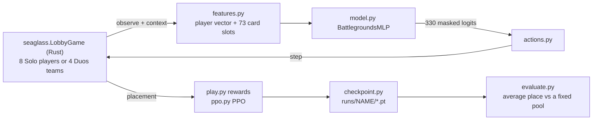

# Seaglass RL (`rl/`)

`seaglass-rl` is the Python reinforcement learning project for training agents to play Hearthstone Battlegrounds on top of the [`seaglass` Rust engine](../engine/README.md).

**All game rules live in Rust; all RL decisions live in Python.**
This package never reimplements a card, cost, legality check, or combat step—it calls the `seaglass` native extension for state transitions and batch combat simulations, while keeping the MDP formulation (observation encoding, action space mapping, reward shaping, and opponent curriculum) and neural network training in Python for rapid iteration.

---

## Overview



| Module | What it does |
| :--- | :--- |
| `seaglass.LobbyGame` (Rust) | The game: a full lobby, Solo (2..8 players) or Duos (2..4 teams of 2), with one shared card pool. It runs the hero offers, each turn's pairings, ghosts, combats, knockouts and placements, and records every game as a replay ([`engine/docs/lobby_game.md`](../engine/docs/lobby_game.md)). `context(p)` is what player `p` knows about the lobby. Python holds no game logic. |
| `play.py` | `LobbyConfig` (the lobby settings) and `Seat` (one player with the `TavernGame` interface, so the bots and `action_mask` play Solo and Duos alike). `play_games`: plays many lobbies in lockstep with one batched forward pass per model, with a mix of controllers per unit (`"learner"`, `"heuristic"`, `"random"`, or a named model such as a checkpoint), and records the learner's decisions as trajectories. `Player` spreads games over worker processes. |
| `ppo.py` | GAE with **per-turn discounting** and a minibatched, KL-limited PPO update. |
| `train_lobby.py` | The trainer (below). |
| `pretrain.py` | Behavior cloning on HeuristicBot games (policy cross-entropy + value regression), the starting point for PPO (`train_lobby.py --init`). |
| `evaluate.py` | Average placement (with standard error, top-half and first-place rates) of a checkpoint against a fixed pool. |
| `checkpoint.py` | `save` / `load`. A checkpoint stores the model's config and weights, the optimizer state, and the feature spec it was trained on; loading one with another feature spec fails. |
| `features.py`, `actions.py`, `model.py` | The observation encoding, the 330 flat actions with their legality mask, and the network. |
| `bots.py` | `RandomBot`, `HeuristicBot` (picks the best stats, plays everything, levels on curve), `PolicyBot`. |
| `env.py`, `train_ppo.py` | **Legacy**: the earlier head-to-head 2-player env (`BattlegroundsEnv`) and its trainer. |
| `replays.py` | Recorded matches as training arrays (`to_dataset`), e.g. for behavior cloning. |

---

## Training (`train_lobby.py`)

```bash
python -m seaglass_rl.pretrain --out runs/bc-solo.pt --games 400                 # clone the HeuristicBots
python -m seaglass_rl.train_lobby --run-dir runs/solo --init runs/bc-solo.pt --lr 1e-4
python -m seaglass_rl.train_lobby --run-dir runs/solo --iterations 500           # Solo, 8 players, from scratch
python -m seaglass_rl.train_lobby --run-dir runs/duos --duos --iterations 500    # Duos, 4 teams
python -m seaglass_rl.train_lobby --run-dir runs/solo --resume runs/solo/latest.pt --iterations 500
python -m seaglass_rl.evaluate runs/duos/latest.pt --duos --games 200
```

**Start from behavior cloning.** From scratch, an untrained policy places last against HeuristicBots nearly every game, and a reward that arrives only at the end of the game is too weak to climb out from there. `pretrain.py` clones the bots in about a minute: 95% held-out action accuracy, average place 4.9 against them in Solo and 2.7 in Duos. PPO then starts from there (`--init`).

The policy's logits get a **kind prior** (`model.py`, on for `train_lobby`): each is lowered by log(number of legal actions of its kind). An untrained policy then picks among Buy, Play, Reposition, End Turn and the rest evenly, instead of mostly Repositioning: there are 42 Reposition actions and 1 End Turn.

Each iteration plays `--games` lobbies (64) across `--workers` processes (12):
- **Who plays.** The learner controls `--learner-units` units: half by default, so 4 Solo players or 2 Duos teams. In Duos both teammates use the learner's policy, each acting on their own Tavern. Each other unit is a HeuristicBot (`--p-heuristic`, 30%) or a frozen snapshot of the learner. Snapshots are taken every `--snapshot-every` iterations, and the last `--pool-size` are kept.
- **Reward.** The unit's **placement**: +1 for first down to -1 for last, linear (`play.placement_reward`). A Duos team's two players share it.
- **Optional shaping.** `--shaping` (default 0.3) adds potential-based shaping, γ·Φ(s′) − Φ(s), with Φ = shaping × log1p(`env.compute_board_power`). Being potential-based, it changes no optimal policy; it only gives credit earlier.
- **Discounting.** `--gamma` (0.97) applies once per turn, not per action, so a 10-action turn isn't discounted ten times.
- **Actions.** Everything is unmasked, including Freeze. `--prune` restores the `prune_dominated` sell and refresh rules. A turn is force-ended after `--max-steps-per-turn` (30) actions.
- **End-of-turn step.** A model's turn has two parts. **Shopping** covers everything but Reposition and Toggle Freeze; where a card is played still picks its slot. Choosing End Turn opens an **end-of-turn step** ("prepping the board for battle") when there is something to do in it. The only legal actions in the step are Reposition (at most board size − 1 moves, with 2+ minions), **one** Toggle Freeze, and End Turn. The turn ends once nothing is left to do. The observation flags the step (`features.PHASE_OFFSET`). `--no-positioning-phase` allows repositioning and freezing at any time. Without the step, the models made 6–12 moves a turn, and toggled Freeze on and off to pad turns.
- **Damage caps.** Lobbies cap combat damage as the game does (`engine/docs/lobby_game.md` §5). `--no-damage-caps` turns this off.
- **Update.** `--epochs` (4) passes of minibatches (`--minibatch` 4096). An epoch stops early once the approximate KL passes 1.5 × `--target-kl`.

Every `--eval-every` iterations, the learner plays `--eval-games` lobbies alone against HeuristicBots, and `latest.pt` is saved. `runs/NAME/` holds:
- `args.json`;
- `log.jsonl`, one line per iteration: the learner's average place, steps, losses, entropy, KL, explained variance, and the evaluation;
- `latest.pt`;
- `snapshots/iter_XXXXX.pt`.

Evaluation. An agent as good as the field places `(units + 1) / 2` on average: 4.5 in Solo, 2.5 in Duos. Lower is better.

### Simplifications compared with the real game
- No damage cap (`engine/docs/deferred.md`).
- A game still running after `--max-turns` (30) places the survivors by Health plus Armor.

---

## Observation (`features.py`)

`encode_observation(obs, context=None)` returns `(player_vec, slot_card_ids, slot_num_feats)`:

- **`player_vec`** (`PLAYER_DIM` = 192):
  - The player's Tavern: 33 features (`TAVERN_PLAYER_DIM`), described in the sections below.
  - The lobby (`LOBBY_DIM` 20, all 0 without a `context`): units, units alive, Health rank, whether the next opponent is a ghost, the next opponent's Health, Armor and Tier, this turn's damage cap (capped, cap / 15), and the lobby's 5 minion types (a multi-hot of the 10).
  - 7 opponents × 10 features (`OPPONENT_DIM`): present, alive, Health, Armor, Tier, win streak, is next, is last, whether this player has seen their board, and how many turns ago. The next opponent comes first (in Duos, the opposing player in this seat, then their teammate), then the rest by Health.
  - The Duos team (`DUOS_DIM` 11, 0 in Solo): the teammate's Tier, Gold, ended, has a hero, fights first, free Passes, both incoming queues, and the team's Pass counters.
  - Whether the player is in the positioning step (`PHASE_OFFSET`).
  - The player's game-long counters (`COUNTERS_OFFSET`, 57): `TavernObservation.player_counters` in `seaglass.player_counter_names()` order (the scaling buffs: Blood Gems, Tavern spell power, Undead Attack, the Tavern buffs per minion type; the tallies card text reads; the deity; the last combat's result), then both Hero Powers' counters and stacks. All are sign-preserving log-scaled (`symlog`).
- **101 card slots** (`NUM_SLOTS`), each a card id (embedded) plus `SLOT_NUM_DIM` = 99 numeric features. After the keywords, Dark Gifts and trinket types come the minion types the card counts as (`TRIBES_OFFSET`, a multi-hot of the 11 single types), its counter (`COUNTER_OFFSET`), and 15 more (`UNIT_EXTRA_OFFSET`): Stealth, a spell's price and Health cost, unplayable and turns locked, stacks, charges, Avenge progress, permanent stats and Blood Gems gained, Deathrattles given, Attack/Health above base, activated this turn. The slots are:
  - The player's Tavern: board 7, hand 10, shop 7, Discover 4, waiting 3, trinkets 2, trinket offers 4 (`TAVERN_SLOTS` = 37).
  - The hero and the offered heroes (`HERO_OFFSET`, 1 + 4). Hero ids are appended to the card vocabulary.
  - The Duos teammate's board and hand (`TEAMMATE_OFFSET`, 7 + 10).
  - The next opponents' boards **as this player last saw them**, in their own last combat against them (`OPPONENT_BOARD_OFFSET`, 2 × 7; empty if never fought).
  - The Duos teammate's shop (`TEAMMATE_SHOP_OFFSET`, 7), the opponents' heroes (`OPPONENT_HERO_OFFSET`, 7), the "this game" card counters (`CARD_COUNTER_OFFSET`, 8: the card, then its two values where Attack and Health go: Eternal Knight deaths, ...), and the player-level effects (`EFFECT_OFFSET`, 6: the card, its stacks, whether it lasts this turn only).

The lobby features hold only what the game shows a player: the leaderboard (each opponent's Health, Armor, Tier and win streak) and the boards *this player* fought. They come from `seaglass.LobbyGame.context`, never from the engine's internal `Lobby` (featured pair, gifts, deaths). Neither observation exposes that `Lobby`.

---

## Static card features (`card_features.py`)

A learned card embedding has to learn every card's effect from experience, and a rare card gets few updates. `static_card_table()` gives each vocabulary entry a fixed description that models can read instead (`STATIC_DIM` 278, a non-persistent buffer, so checkpoints don't store it):
- Engine tags (`seaglass.card_tags()`, 246): which hooks the engine implements for the card (Battlecry, Deathrattle, Rally, Start of Combat, end of turn, auras, Hero Power and trinket triggers, ...), its `CardFlags`, Activate / targeted spell / spell aura, and for minions the printed Tier (one-hot), Attack and Health `/ 10`, types and keywords. A hero has its Hero Power's tags.
- A rules-text embedding (32): `scripts/embed_card_text.py` embeds every card's text from the engine's doc comments (and the Hero Power texts in `heroes/table.rs`) with `all-MiniLM-L6-v2`, reduces it with PCA and saves `seaglass_rl/data/card_text_embeddings.npz`. Rerun it when cards change. About 2% of the vocabulary (unimplemented trinkets) has no text and gets zeros.

`BattlegroundsMLP(static_features=True)` adds a learned projection of a card's static row to its embedding, at no rollout cost (`card_table()` is computed once per `act_batch`).

---

## Model (`BattlegroundsMLP`)

Each slot's card embedding (`--embed` 16) is concatenated with the slot's numeric features and the player vector. The result goes through a 2-layer MLP (`--hidden` 256, about 1.8M parameters) with an actor head (330 masked logits) and a critic head. It has a NumPy fast path (`act_batch`) for rollouts. A set or attention encoder over the slots, with per-card action heads, is the planned next model.

---

## Duos

A Duos team (two players with one Health pool who can Pass cards to each other, [`engine/docs/duos_tavern.md`](../engine/docs/duos_tavern.md)) is `seaglass.DuosTavernGame`. `seaglass.LobbyGame(duos=True)` plays 4 of them as one game, with one shared card pool, and `train_lobby.py --duos` trains on it.

### Bindings
- `DuosTavernGame(seed=0, catalog="duos", armor=(5, 5), first_fighter_switch_chance=0.75, shop_spells=True, deity=None)`: one team's Tavern phase, with its card pool and RNG (everything is deterministic from `seed`). `armor` is each hero's starting Armor (the team starts with 30 Health and their sum); `catalog="duos"` is the full catalog plus the Duos-exclusive minions (`Wanderer Cho`).
- Per player (`0` or `1`): `observe(player)`, `legal_actions(player)`, `is_legal(player, action)`, `step(player, action)` (returns `True` if it ended that player's turn), `end_turn(player)`.
- Per team: `start_turn()` (both players, then the coming combat's first fighter), `turn_over()` (both players ended), `is_out()`, `health`, `armor`, `first_fighter`; `resolve_combat_with(other, seed=None)` (team vs team: both take their results, the loser the damage) and `resolve_combat_against(opponent, first=0, hero_tiers=(1, 1), seed=None)` (a fixed opponent team: its two boards). Both return a `DuosBattleResult` (`outcome`, `hero_damage`, `fought_a`/`_b`, `survivors_a`/`_b`, per player). Two `DuosTavernGame`s have separate card pools (a 4-team match with one pool is `seaglass.LobbyGame(duos=True)`).
- `TavernAction.pass_card(hand_index)`: kind `"pass"`, args `(hand_index, None)`. A Solo `TavernGame` never lists it as legal.
- `simulate_duos(team_a, team_b, seed, first_a=0, first_b=0, hero_tiers_a=(1, 1), hero_tiers_b=(1, 1))` and `simulate_duos_batch(team_a, team_b, base_seed, n, ...)`: Duos combat equity, where a team is its two players' boards (`[[units], [units]]`).

### MDP
- **Agents**: each player is an agent acting on their own Tavern, with the same policy for both teammates. Both act during the same turn: `play.py` interleaves their actions (one teammate at a time, alternating, because a player's action can change their teammate's Tavern) until both have ended; then the teams fight. Both teammates get the team's placement as their reward.
- **Actions**: the Solo table plus 10 `Pass` actions, one per hand slot, appended at the end (`PASS_INDICES`), so Solo indices keep their meaning and Solo masks leave them out. `action_mask(game, ..., player=p)` masks a Duos player's actions (a `lobby.Seat` needs no `player`).
- **Observation** (`DuosObservation`): the player's own `TavernObservation` fields (with the team's `health` and `armor`), plus `incoming` (the cards passed to them waiting for room in a full hand), `free_passes`, `fights_first`, `ended`; the teammate's `teammate_board`, `teammate_hand`, `teammate_shop`, `teammate_tavern_tier`, `teammate_gold`, `teammate_incoming`, `teammate_ended`, `teammate_free_passes`; and the team's `team_health`, `team_armor`, `passes_this_turn`, `passes_this_game`, `first_fighter`.
- **Encoding**: the teammate's board and hand are card slots (`TEAMMATE_OFFSET`), and the team scalars are the `DUOS_DIM` player features ([Observation](#observation-featurespy)). The card vocabulary includes the Duos-exclusive cards: their ids (`10_000` and up) sort after every Solo card, so they only append to it.

---

## Heroes

Heroes and their Hero Powers ([`engine/docs/heroes.md`](../engine/docs/heroes.md)) are optional: a game without a hero (the default) is exactly as before.

### Bindings
- `TavernGame(..., hero=None)`: a hero by name (`"Y'Shaarj"`) or id (its dbfId, `66196`) gives the player its Health, Armor (then `armor` is ignored) and Hero Power. `DuosTavernGame(..., heroes=None)`: a pair `(hero_0, hero_1)` (each a name, an id or `None`); the team gets 30 Health plus both heroes' Duos Armor (Patchwerk: his extra 30 Health), replacing `armor`.
- `TavernAction.hero_power(target=None)` (kind `"hero_power"`, args `(target, None)`): use the Hero Power, on a board, shop or hand index if it needs one (`0..7` board or `7..14` shop for `BoardOrShopMinion`). `TavernAction.hero_power_2(target=None)` (kind `"hero_power_2"`, args `(target, None)`): use the second Hero Power (Genn, Worgen King). `TavernAction.choose_hero(option_index)` (kind `"choose_hero"`): choose an offered hero; while heroes are offered, it is the only legal action.
- `heroes_table()`: `(id, name, implemented)` for each of the 123 heroes of the pool.
- `Lobby(players, duos=False)`: what the players of a game know about each other ([`engine/docs/tavern.md`](../engine/docs/tavern.md) §3.1), for the lobby Hero Powers (Scabbs, Tess, Bigglesworth, Barov, Holmes, Mukla). Each turn: `set_next_pairs([(a, b), ...])` (the first pair is featured: Lord Barov's wager) and `apply(games)` before the turns start (`games[p]` is player `p`'s `TavernGame`), `deliver_gifts(games)` after them and after the players' turns (each player's lobby gifts, Mukla's Bananas, to their living opponents), then `record_combat(player, opponent, board)` (the board as it entered combat), `record_outcome(a, b, outcome)` and `record_deaths(alive)` after the combats. Duos: `Lobby(2 * teams, duos=True)` with `apply_duos(teams)` / `deliver_gifts_duos(teams)` (team `t`'s players are `2t` and `2t + 1`; a teammate's Banana goes through the team). `TavernGame.take_lobby_gifts()` and `DuosTavernGame.take_lobby_gifts(player)` take a player's undelivered gifts. `BattlegroundsEnv` keeps a `Lobby(2)`: each player is the other's next and last opponent, with no featured pair (Lord Barov can't wager).
- The engine's `Lobby` is never in the observation: `TavernObservation` and `DuosObservation` don't expose it. The lobby features (`features.py`) encode only what the game shows a player, from `seaglass.LobbyGame.context`: the leaderboard and the boards opponents fought with. Lord Barov's own wager is in `hero_power_armed`.
- `draw_hero_offers(players, per_player=2, duos=False, dark_gifts=True, seed=0)`: a lobby's hero offers (`docs/heroes.md` §6). `TavernGame.offer_heroes(options)` and `DuosTavernGame.offer_heroes(player, options)` offer them; until the player picks one (`choose_hero`), it is the only legal action. `TavernGame.copy()` and `DuosTavernGame.copy()` (also `copy.copy` / `copy.deepcopy`) are independent copies, state, pool and RNG, for lookahead.

### Observation
`TavernObservation` and `DuosObservation` have `hero_id` (0 without a hero), `hero_power_id` (the Hero Power card in use: it changes with Bru'kan's Element), `hero_power_cost`, `hero_power_uses_left`, `hero_power_counter`, `hero_power_stacks`, `hero_power_armed` (next-combat effects paid for: Y'Shaarj; for a power with a picked minion, Vol'jin's first pick, that minion's current target + 1: `1..=7` board, `8..=14` shop), `hero_power_usable` (some `HeroPower` action is legal now), `second_hero_power_id` (0 without a second Hero Power), `second_hero_power_cost`, `second_hero_power_uses_left`, `second_hero_power_counter`, `second_hero_power_stacks`, `second_hero_power_armed`, `second_hero_power_usable` and `hero_options`; `DuosObservation` also has `teammate_hero_id`. `features.py` appends six of them to the `[PLAYER]` vector (`PLAYER_DIM` is 17 with the next ones): has a hero, `hero_power_usable`, `hero_power_cost / 10`, `hero_power_uses_left`, `hero_power_armed / 3`, and whether heroes are offered. Freezing (`engine/docs/tavern.md` §3.1) is appended after them: `is_frozen` (the whole shop) ends the `[PLAYER]` vector, and each slot's last numeric feature (`SLOT_NUM_DIM` is 13) is `Unit.frozen`, a shop card frozen on its own (Varden Dawngrasp's copies). `ToggleFreeze` unfreezes everything when anything is frozen, and freezes the shop otherwise. Then `next_minion_discount / 3` (the next minion bought costs that much less: Aranna Starseeker's free minion). Last, the cards waiting for room in the hand (`waiting_for_hand` on both observations: Spellcraft spells given to a full hand, delivered once there is room and discarded at the end of the turn, `engine/docs/tavern.md` §7.4): their count `/ 3` follows in the `[PLAYER]` vector, and the first 3 are card slots appended after the Discover ones (`MAX_WAITING`; `NUM_SLOTS` is 31). Then the prices a Hero Power can change (`engine/docs/tavern.md` §3.3; both observations have `minion_cost` and `refresh_cost`, and `upgrade_cost` is the Upgrade's price with its extra): `minion_cost / 3` and `refresh_cost / 2`, followed by the five second-Hero-Power features (has a second power, `second_hero_power_usable`, `second_hero_power_cost / 10`, `second_hero_power_uses_left`, `second_hero_power_armed / 3`), end the `[PLAYER]` vector (`PLAYER_DIM` is 25). Each slot's 14th numeric feature (`SLOT_NUM_DIM` is 14) is `Unit.marked` (marked by the Hero Power: a Silas Darkmoon ticket). A turn the hero skips (A. F. Kay, Faelin) leaves only `EndTurn` (and `ChooseDiscover`) unmasked.

### Actions
After the Duos `Pass` actions, the table appends 11 `HeroPower` actions (`HERO_POWER_INDICES`: untargeted, then targets `0..10`), 4 `ChooseHero` actions (`CHOOSE_HERO_INDICES`; 2 heroes are offered by default), 4 extra `HeroPower` target actions (`HERO_POWER_EXTRA_INDICES`: targets `10..14` for `BoardOrShopMinion`), and 15 `HeroPower2` actions (`HERO_POWER_2_INDICES`: untargeted, then targets `0..14`). A player without a hero never lists them as legal.


---

## Trinkets

Trinkets ([`engine/docs/trinkets.md`](../engine/docs/trinkets.md)) are optional: a game without trinket offers (the default) is exactly as before.

### Bindings
- `TavernGame(..., trinkets=True)` and `DuosTavernGame(..., trinkets=True)`: on by default (`trinkets=False` turns them off), the offers: a Lesser one at the start of turn 6 and a Greater one at the start of turn 9 (4 options each; per player in Duos). Only implemented trinkets are offered.
- `TavernAction.choose_trinket(option_index)` (kind `"choose_trinket"`, args `(option_index, None)`): pick an offered trinket, paying its price in Gold. While trinkets are offered, it is the only legal action (no skipping); an unaffordable option is illegal (if none is affordable, the cheapest ones are free).
- `trinkets_table()`: `(id, name, greater, cost, implemented)` for each of the 246 trinkets of the pool (HSReplay's 237 Solo trinkets and the 9 Duos-exclusive ones). Their ids are appended at the end of `all_card_ids()`, so they are in the card vocabulary, in a fixed append-only order: the 18 trinkets that left the pool keep their index. The cards added to the engine since (the trinkets' Spellcraft spells, new tokens) come last, after the Dark Gifts, in the order they were added (`engine/src/vocab.rs`): `tests/test_vocabulary.py` checks that `all_card_ids()` still starts with the first vocabulary (`tests/data/card_ids_v1.txt`).

### Observation
`TavernObservation` and `DuosObservation` have `trinkets` (the owned trinkets' ids, in the order picked), `trinket_counters` (their counters), `trinket_options` (the offered trinkets' ids) and `trinket_option_costs` (their prices: 2 less for an option of a type that isn't the player's most common one). `features.py` appends six features to the `[PLAYER]` vector (`PLAYER_DIM` is 31): whether trinkets are offered, the number owned `/ 2`, and the 4 offered prices `/ 10` (0 for no option); and six card slots after the waiting ones (`NUM_SLOTS` is 37): the 2 owned trinkets (`MAX_TRINKETS`), then the 4 offered ones, each with its id and the present flag.

A trinket whose text names a minion type (`Colorful Compass`, `Gold-plated Compass`, `Minion Bait`: "Get a random Beast") gets the player's most common type as it is offered ([`engine/docs/trinkets.md`](../engine/docs/trinkets.md) §3.4). Both observations have `trinket_tribes` and `trinket_option_tribes` (each owned and offered trinket's type: its index in the 10 lobby types plus 1, 0 for none), and every card slot's numeric features end with a one-hot of the 10 lobby types (`TRINKET_TRIBE_OFFSET`, after the Dark Gift features; `SLOT_NUM_DIM` was 14 + 47 + 10 = 71), set only in the trinket slots.

### Actions
The table appends 4 `ChooseTrinket` actions (`CHOOSE_TRINKET_INDICES`). A game without trinket offers never lists them as legal.

---

## Dark Gifts

Dark Gifts ([`engine/docs/dark_gifts.md`](../engine/docs/dark_gifts.md)) are optional: a game without the Dark Discovery button (the default) is exactly as before.

### Bindings
- `TavernGame(..., dark_gifts=True)` and `DuosTavernGame(..., dark_gifts=True)`: on by default (`dark_gifts=False` turns it off), every player has the Dark Discovery button (3 Gold, from turn 3, once per turn, 3 uses per game; per player in Duos). Only implemented gifts are offered.
- `TavernAction.dark_discovery()` (kind `"dark_discovery"`, args `(None, None)`): use the button. It Discovers 1 of 3 minions, each with a different Dark Gift (a regular `choose_discover` prompt).
- `Unit.dark_gifts`: the gift ids (dbfIds) on a card, in the order it got them.
- `dark_gifts_table()`: `(id, name, min_turn, max_turn, weight, implemented)` for each of the 47 gifts (`max_turn` 0: none). `dark_gifts_vocabulary()`: their ids in a fixed append-only order, which are also appended at the end of `all_card_ids()`, after the trinkets.

### Observation
`TavernObservation` and `DuosObservation` have `dark_gifts_enabled`, `dark_discoveries_left` (the button's uses left this game, 0 without it) and `dark_discovery_usable` (`dark_discovery` is legal now). `features.py` appends two features to the `[PLAYER]` vector (`PLAYER_DIM` is 33): the uses left `/ 3` and whether it is usable; and to every card slot one feature per gift of the vocabulary (`DARK_GIFT_IDS`), the number of copies of that gift on the card, after the 14 earlier ones (`SLOT_NUM_DIM` is 14 + 47 = 61).

### Actions
The table appends the `dark_discovery` action last (`DARK_DISCOVERY_INDEX`). A game without Dark Gifts never lists it as legal.

## Darkmoon Prizes

Darkmoon Prizes ([`engine/docs/darkmoon_prizes.md`](../engine/docs/darkmoon_prizes.md)) need no new action or feature: a prize is a 0-Gold spell (or the minion `All-Seeing Elder`) cast with the existing `play` actions, and a prize Discover is a regular `choose_discover` prompt. The prize ids and `Corrupted Tome`'s `Triple Prize` are appended to `all_card_ids()` (`engine/src/vocab.rs`), so they have card embeddings in the hand and Discover slots. `Tickatus`'s turns toward the next prize are `hero_power_counter`. `Gruul Rules` gives a minion `+4/+4` at each end of turn (`Unit.end_of_turn_stats`, visible on the card): every card slot's last numeric feature is `log1p(end_of_turn_stats) / 5` (`END_OF_TURN_STATS_OFFSET`, after the trinket types; `SLOT_NUM_DIM` is 14 + 47 + 10 + 1 = 72).

---

## Package Layout

```text
rl/
├── README.md
├── pyproject.toml
├── seaglass_rl/
│   ├── play.py          # Lockstep play of seaglass.LobbyGame with mixed controllers, trajectories
│   ├── ppo.py           # Per-turn GAE and the minibatched PPO update
│   ├── train_lobby.py   # The trainer (league of snapshots + HeuristicBots)
│   ├── pretrain.py      # Behavior cloning on HeuristicBot games
│   ├── evaluate.py      # Average placement against a fixed pool
│   ├── checkpoint.py    # Save / load models with their feature spec
│   ├── features.py      # Observation encoding
│   ├── actions.py       # Action space and masks
│   ├── model.py         # BattlegroundsMLP
│   ├── bots.py          # RandomBot, HeuristicBot, PolicyBot
│   ├── env.py           # Legacy head-to-head env (BattlegroundsEnv)
│   ├── train_ppo.py     # Legacy head-to-head trainer
│   └── replays.py       # Recorded games -> training arrays
└── tests/               # test_lobby.py covers the lobby, play, PPO, checkpoints and evaluation
```

---

## Quickstart

```bash
cd rl && source .venv/bin/activate
maturin develop --release --manifest-path ../engine/Cargo.toml --features python
pytest
python -m seaglass_rl.pretrain --out runs/bc-duos.pt --duos
python -m seaglass_rl.train_lobby --run-dir runs/duos --duos --init runs/bc-duos.pt --lr 1e-4 --iterations 300
python -m seaglass_rl.evaluate runs/duos/latest.pt --duos --games 200
```

### Watch lobby games

Every `seaglass.LobbyGame` is a recorded match, Solo or Duos. Save a few evaluation games and
step through them:

```bash
python -m seaglass_rl.evaluate runs/duos/latest.pt --duos --games 8 --replays runs/watch
cargo run --release --bin match_replay -- tui runs/watch/duos_1000000.replay.pb
```

`train_lobby.py --replays` saves a few games at every evaluation (`RUN_DIR/replays/iter_XXXXX/`).
The learner's actions carry its value and log-probability. Duos and ghost combats show as a
line (who fought, the result) for now, without their event playback.

### Record, watch and reuse games (legacy head-to-head env)

Every game the head-to-head env and its trainer (`train_ppo.py`) play is a recorded `seaglass.Match`
([`engine/docs/replays.md`](../engine/docs/replays.md) §5). Policy actions carry their value
estimate and log-probability, and forced moves are marked. `--replays DIR` saves the evaluation
games and the last game of every logged iteration (~4 KB each):

```bash
python -m seaglass_rl.train_ppo --iterations 25 --episodes-per-iter 8 --replays runs/replays
cargo run --release --bin match_replay -- step runs/replays/final_heuristic_000.replay.pb
```

`env.match.save(path)` saves the current episode. `seaglass_rl.replays` turns replays into
training arrays shaped like the trainer's batches, e.g. for behavior cloning or value fitting:

```python
from pathlib import Path
from seaglass_rl import replays

data = replays.to_dataset(sorted(Path("runs/replays").glob("*.replay.pb")), player="agent")
data["player_vec"], data["action_mask"], data["actions"], data["outcome"]
```
